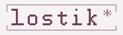

<b>Обратная связь</b>
 Ошибки, предложения и вопросы по lostik.

  

<b>Ошибка</b> &middot; Что произошло, что ожидалось и как повторить. 
<b>Предложение</b> &middot; Какую задачу решит изменение и как оно должно работать. 
<b>Интерфейс</b> &middot; Где неудобно, на каком устройстве и что стоит изменить.

Перед отправкой

Проверьте, нет ли похожего обращения. Для каждой проблемы создавайте отдельное. Обращения видны всем. Не публикуйте личные переписки и данные для входа.

<a href="https://github.com/lostik-app/feedback/issues">Все обращения</a> &middot; <a href="https://github.com/lostik-app/feedback/security/advisories/new">Сообщить об уязвимости</a> &middot; В разработке.

